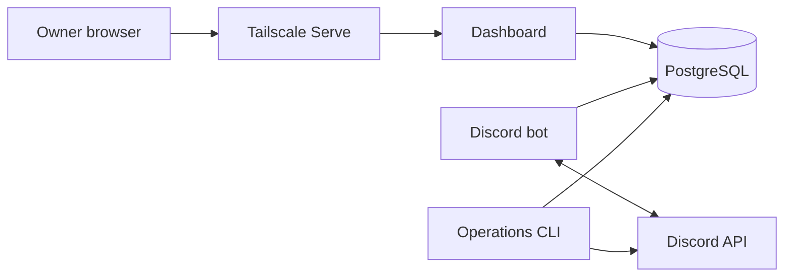

# Architecture overview

The system is a modular monorepository with four executable applications and
two shared packages.

## Modules and seams

| Module                    | Interface                     | Implementation hidden behind it                |
| ------------------------- | ----------------------------- | ---------------------------------------------- |
| Guild blueprint           | Immutable desired guild state | Ordering, names, roles, permissions            |
| Custom moderation         | Inspect one Discord message   | Sliding windows, normalization, thresholds     |
| Configuration publication | Publish one validated version | Validation, audit, atomic activation           |
| Audit journal             | Append and query events       | PostgreSQL schema, retention, filtering        |
| Discord adapter           | Apply desired state           | Rate limits, hierarchy, retries, audit reasons |

The pure domain package contains policy and desired state. Discord and
PostgreSQL are adapters at explicit seams, not dependencies of the policy.

## Runtime isolation

- `bot` remains available when the dashboard restarts.
- `dashboard` never receives the Discord token or Docker socket.
- PostgreSQL is the source of truth.
- Redis is intentionally absent until measured contention requires it.
- The bot caches the last published moderation configuration.

## Related notes

- [Repository map](repository-map.md)
- [Discord structure](../discord/server-structure.md)
- [Automoderation](../modules/automod.md)
